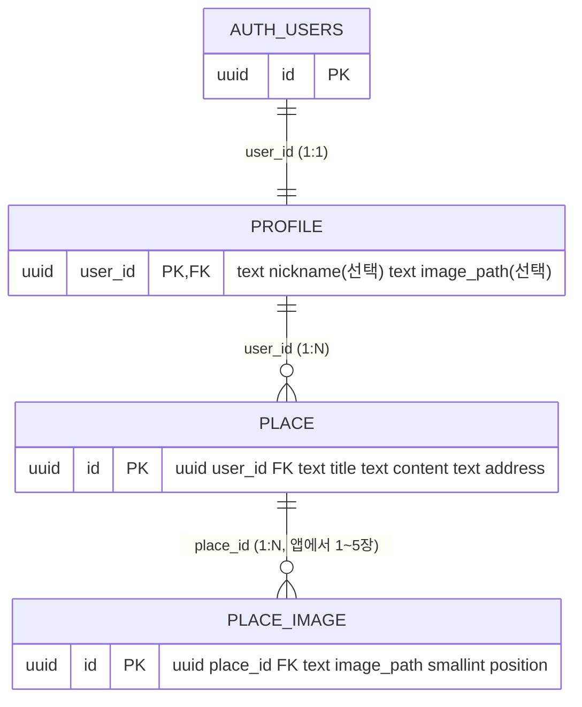

# Day55 맛집 커뮤니티 데이터 설계

Hi-Fi 핸드오프(`12-food-handoff-hi-fi`의 화면 코드와 Storybook)와 PRD v0.3에서 화면 데이터를 추출해 정규화했다. `design.pen`은 암호화 형식이라 직접 읽지 않고, 그 6개 화면을 옮긴 핸드오프 코드를 근거로 삼았다. 전체 표는 [data-dictionary.xlsx](data-dictionary.xlsx)에 있다.

## 관계

- `auth.users`가 회원 원본이다. 가입 트리거 `on_auth_user_created`가 `profile` 1:1 행을 만든다.
- `place.title`, `content`, `address`, `user_id`와 `place_image.image_path`, `place_id`는 NOT NULL이다. `profile.nickname`, `image_path`는 선택값이다.
- 이미지 파일은 Storage에, DB에는 `userUUID/uuidv4.ext` 경로만 저장한다. 화면 URL은 서버에서 `SUPABASE_STORAGE_URL`과 조합한다.
- PRD의 위도·경도는 지도 단계(Day58)에서 별도 migration으로 추가한다.

## Storage

| 버킷 | 공개 | 파일 제한 | 형식 | 쓰기 권한 |
| --- | --- | --- | --- | --- |
| `profile-image` | 공개 읽기 | 5MB | jpg, png, webp | 경로 첫 폴더가 본인 UUID |
| `place-image` | 공개 읽기 | 10MB | jpg, png, webp | 경로 첫 폴더가 본인 UUID |

공개 버킷은 URL로 읽으므로 공개 조회 정책을 두지 않는다. 소유자 SELECT 정책은 삭제와 존재 확인에 쓴다. 파일 교체는 하지 않고 새 경로로 올린다.

## RLS

세 테이블 모두 RLS를 켠다. `anon`과 `authenticated`는 조회만, 쓰기는 `authenticated`이면서 `user_id = auth.uid()`일 때만 허용한다. 새 프로젝트는 Data API 자동 노출이 없어 grant를 migration에 명시했다. `profile.image_path`와 `place_image.image_path`도 본인 폴더만 가리키도록 정책으로 막는다. `profile` 직접 삭제는 앱에 없어 열지 않았고, 회원 삭제 시 cascade로 지워진다.

## 적용 순서

동일 프로젝트에 한 번씩, 아래 순서로만 적용한다. 각 단계 폴더는 앞 단계 migration을 포함하므로 **가장 최신 단계 폴더에서 한 번 `supabase db push`** 하면 된다. base를 폴더마다 다시 실행하지 않는다.

| 순서 | migration | 도입 단계 | 내용 |
| --- | --- | --- | --- |
| 1 | `community_base` | Day55·18 | 테이블, 트리거, RLS, `profile-image`·`place-image` 버킷 |
| 2 | `upload_chunk_bucket` | 19 | 10MB를 BFF로 받기 위한 비공개 청크 버킷 |
| 3 | `save_place` | 20 | 글과 이미지 경로를 한 트랜잭션으로 저장하는 RPC |
| 4 | `place_soft_delete` | 21 | `deleted_at`, 삭제 글 RLS 차단, 소프트 삭제 RPC |

## 환경변수

`.env.example`을 `.env.local`로 복사해 값을 넣는다. 값은 커밋하지 않고 `service_role`은 쓰지 않는다. baseURL은 `SUPABASE_URL`, `SUPABASE_STORAGE_URL`, `APP_URL`로 분리되어 있다.

## Google OAuth

1. Google Auth Platform에서 동의 화면을 만들고 `Web application` 클라이언트를 만든다. Authorized JavaScript origins는 `http://localhost:3000`이다.
2. Supabase `Authentication`의 Google provider 화면에 표시된 callback URL(`https://<PROJECT_REF>.supabase.co/auth/v1/callback`)을 Authorized redirect URIs에 넣는다.
3. Client ID와 Secret을 Supabase Google provider에 직접 입력한다. 앱 환경변수에는 넣지 않는다.
4. Supabase `URL Configuration`의 Site URL을 `http://localhost:3000`, Redirect URLs를 `http://localhost:3000/auth/callback`으로 설정한다. 배포 후에는 공개 주소를 추가한다.

## 검증 상태

로컬 실제 Postgres와 PostgREST에 migration을 적용해 제약과 RLS를 확인했다(`tests/e2e/schema.test.ts`, `docs/verify.md`). Storage 정책은 실제 Postgres의 `storage.objects` 스텁에서 확인했고 Storage 서버는 가짜다. 실제 Supabase 프로젝트 적용과 Google OAuth 연결은 **아직 하지 않았다**.
